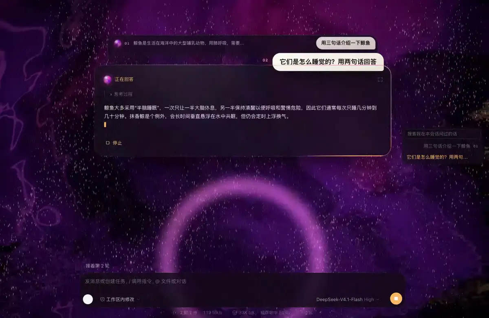

# 小鹿设计（dsh-xiaolu-design）

中文 | [English](README.en.md)

DeepSeek Harness（dsh）的对话区插件：把对话显示成一摞有纵深的叠层，回看前面的任意一轮再提问，会从那里分出一条支流，原来的对话不受影响。



真实 dsh 服务和真实模型回答的录屏，2.5 倍速播放，左侧导航栏已裁掉。原速、原始分辨率的视频见 [docs/demo.mp4](docs/demo.mp4)。

## 它做什么

- **景深舞台**：当前这一轮正对着你，之前的各轮向后退，只露出上沿。它整体替换原来的 Chat 视图，没有标签页和标题栏。
- **支流**：正在看较早的一轮时发出的问题、「重新生成」和「改写问题」，都会开出一条支流。支流继承分叉点之前的全部对话，之后与主线互不可见。同一轮下的各条支流可以左右切换。
- **时间轴**：右侧列出本会话的每一轮，可以搜索你在本会话里问过的话；开始搜索时会把更早的历史取回来。
- **搜索面板**：`Ctrl/Cmd+K` 查找当前会话的某一轮，或其他会话的消息内容。
- **回答工具**：大纲跳转、复制、引用、赞和踩、专注阅读。
- **水面背景**：WebGL 绘制，随思考和回答变化；浏览器不支持 WebGL 时保持应用原背景。

## 运行要求

- dsh `0.2.2-rc.5` 到 `0.3.0` 之前的版本，Web 端。不需要改动 dsh 本身。更早的版本不支持：`0.2.2-rc.1` 没有水面背景用到的 `conversation.hero.frame` 插槽，`rc.2` 到 `rc.4` 没有验证过。

## 安装

```sh
dsh plugin --profile web add github:worldcenterhuhuanni/xiaolu-design
```

仓库里带着构建好的 `lib/`，安装时不需要构建授权。

也可以装 tgz 包。仓库里不带这个文件：从 [Releases](https://github.com/worldcenterhuhuanni/xiaolu-design/releases) 下载，或者在本仓库目录里执行 `pnpm pack` 生成。

```sh
dsh plugin --profile web add ./dsh-xiaolu-design-0.1.1.tgz
```

从源码运行 dsh 时没有全局的 `dsh` 命令：在 dsh 仓库目录里把本文的 `dsh` 换成 `pnpm dsh`，例如 `pnpm dsh plugin --profile web add <包>`，启动用 `pnpm dsh web`。

装好后检查并启动：

```sh
dsh --profile web --dump-config   # 应出现 "# == dsh-xiaolu-design" 这一层
dsh --profile web
```

卸载：`dsh plugin --profile web remove dsh-xiaolu-design`。对话区恢复成原来的 Chat。

## 它往 dsh 里加了什么

`cordis.patch.yml` 做两件事：

- 插入一行 `xiaolu-design`。这一行同时带起宿主端和浏览器端。
- 把 `session-query-sqlite` 的 `openAt` 改成 `first-search`，让搜索面板能搜到其他会话的消息内容。索引在内存里，第一次搜索时才打开。

dsh 没有提供「输入框的消息发到哪个会话」的扩展点，所以浏览器端在自己存活期间包裹了对话服务的 `sendSession`：正在看较早一轮或改写问题时，把这条消息连同附件送进新支流，其余情况原样放行；插件卸载时还原。这个方法不在 dsh 的公开接口里，dsh 升级后如果它改了名，插件会在日志里给出警告，输入框的问题退回为进入当前会话。

宿主端提供两个服务，数据都存在 dsh 的存储域里，不写入会话日志，模型看不到：

| 服务 | 内容 |
| --- | --- |
| `ctx.sessionLineage` | 每条支流从哪个会话的哪个事件分出来、由哪种操作产生 |
| `ctx.sessionGroups` | 用户自己命名的会话分组，以及每个会话属于哪个组 |

支流本身就是普通的 dsh 会话，通过 dsh 自带的会话分叉创建。删掉记录或卸载插件后，支流仍是可以独立打开的会话。

## 已知限制

- 「重新生成」只重发问题的文字，原问题里的附件不会带到新支流。
- 不搜索时，很长的会话里较早的轮次不会出现在时间轴上。
- 用 dsh 原生方式分叉出来的会话不会记入支流树。
- 会话货架和会话总览还在设计中，代码在仓库里但没有注册（见 `src/client/index.ts` 的 TODO）。

## 开发

源码需要放在一份 dsh 源码仓库里构建，因为它用到 dsh 的 Remote 清单生成器和客户端打包器：

1. 把本仓库放到 dsh 仓库的 `packages/experimental/xiaolu-design`。
2. 在 dsh 仓库里登记这个包：根 `package.json` 的 `devDependencies`、`tsconfig.base.json` 的 `paths`、`tsconfig.host.json` 和 `tsconfig.client.json` 的 `references`、`scripts/experimental-package-policy.ts`。
3. 在 dsh 仓库根目录执行：

```sh
pnpm install
pnpm exec tsx scripts/generate-typert.ts
pnpm run build:artifacts
pnpm exec vitest run packages/experimental/xiaolu-design
```

构建产物写到本目录的 `lib/`，随仓库一起提交。

## 许可

MIT，见 [LICENSE](LICENSE)。打包进 `lib/client.js` 的第三方库见 [THIRD_PARTY_NOTICES.md](THIRD_PARTY_NOTICES.md)。
